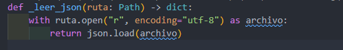
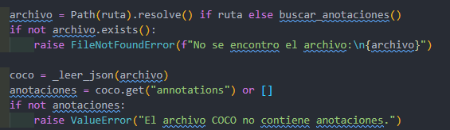
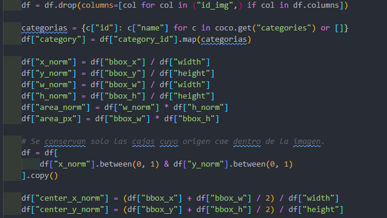
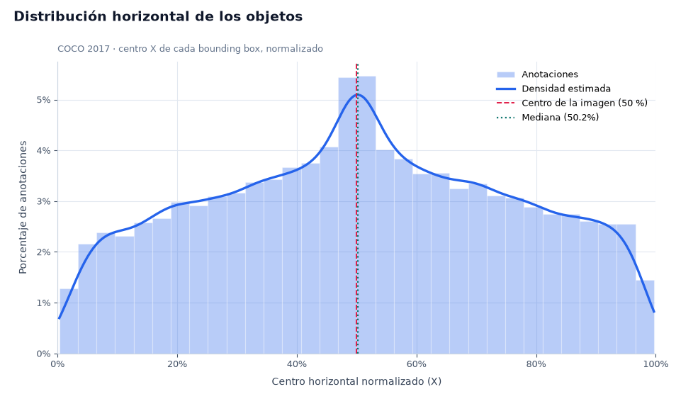
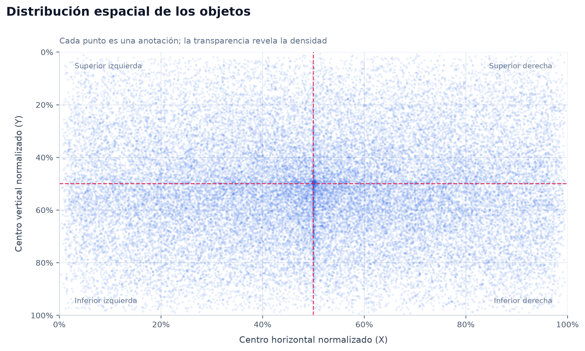
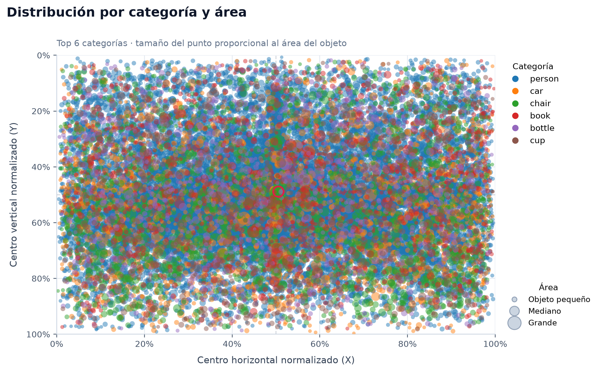
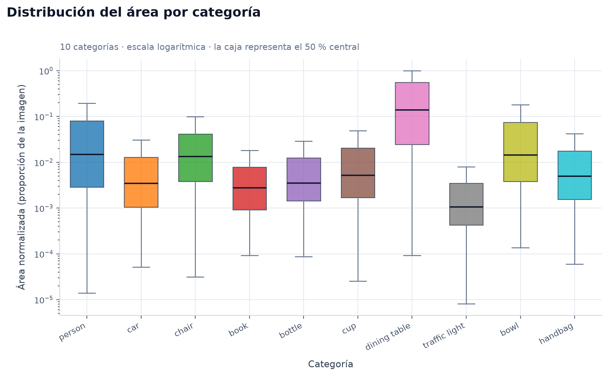
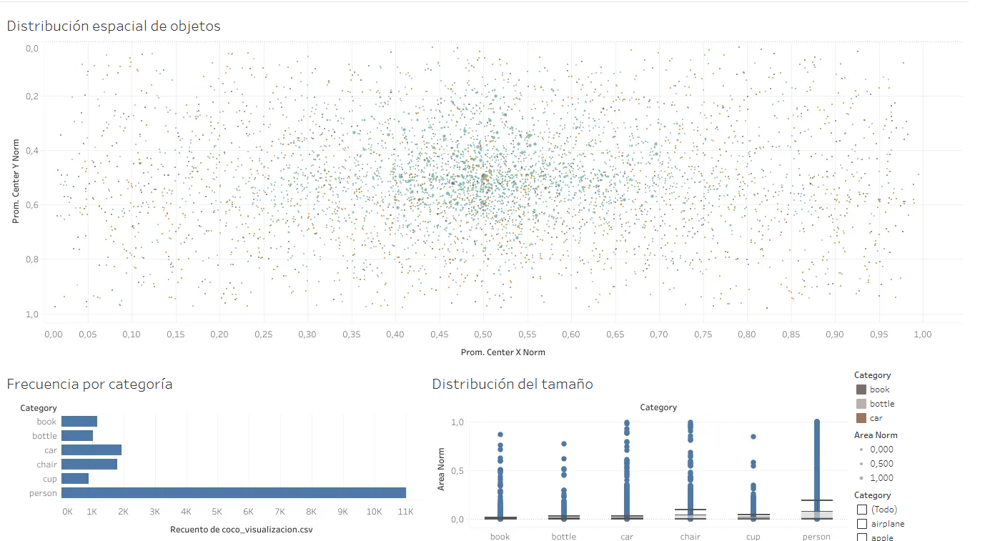

# Proyecto A3-T2: Análisis y visualización de objetos en imágenes COCO 2017

## 1. Descripción del proyecto

Este proyecto analiza la distribución espacial de los objetos identificados en imágenes del conjunto de datos COCO 2017. El propósito es examinar cómo varía la ubicación de los objetos según su categoría y qué patrones se observan en sus tamaños y posiciones dentro de las imágenes.

La pregunta analítica que orienta el proyecto es:

**¿En qué zonas de las imágenes se concentran las diferentes categorías de objetos y qué patrones de distribución presentan?**

Para responderla, se desarrollaron visualizaciones mediante Python y una aplicación de escritorio interactiva con Tkinter y Matplotlib. Adicionalmente, se construyó un tablero interactivo en Tableau Public para explorar la distribución espacial, la frecuencia de las categorías y las áreas de los objetos.

## 2. Fuente de datos

Se utilizó el conjunto de datos **COCO 2017**, específicamente el archivo `instances_val2017.json`, correspondiente a las anotaciones de las imágenes de validación.

- **Fuente:** [COCO 2017 Dataset en Kaggle](https://www.kaggle.com/datasets/awsaf49/coco-2017-dataset).
- **Archivo de anotaciones:** `instances_val2017.json`.
- **Imágenes documentadas:** 5,000.

## 3. Estructura del proyecto

La organización de los archivos utilizados para reproducir el análisis es la siguiente:

```text
├───Dataset
│       instances_val2017.json
│       
└───proyecto_visualizaciones
    │   app.py
    │   config.py
    │   datos.py
    │   exportacion.py
    │   graficas.py
    │   interaccion.py
    │   README.md
    │   requirements.txt
    │   
    ├───salidas
    │       coco_visualizacion.csv
    │       
    ├───ui
    │   │   barra_lateral.py
    │   │   componentes.py
    │   │   estilos.py
    │   │   filtros.py
    │   │   ventana.py
    │   │   vistas.py
```

## 4. Entorno de ejecución y dependencias

El análisis se desarrolló con Python y las siguientes bibliotecas:

| Herramienta | Función |
|---|---|
| Python 3.12.9 | Lenguaje de programación. |
| pandas 3.0.6 | Organización y transformación de los datos. |
| NumPy 2.5.4 | Operaciones numéricas. |
| Matplotlib 3.11.2 | Generación e interacción con las gráficas. |
| Tkinter / Tk 8.6 | Interfaz gráfica de escritorio. |
| Tableau Public | Construcción y publicación del tablero interactivo. |


## 5. Carga de los datos

El archivo `instances_val2017.json` contiene información de las imágenes, las categorías y las anotaciones de los objetos identificados.

La aplicación lee el JSON y organiza la información necesaria para el análisis. De las anotaciones se recuperan, entre otros datos, la categoría del objeto y las coordenadas de su *bounding box*. Estas se relacionan con las dimensiones de la imagen correspondiente para calcular las variables derivadas.

La carga de datos constituye la primera etapa del proceso, ya que permite disponer de una estructura tabular para realizar los cálculos y generar las visualizaciones.

**Evidencia 1. Carga de datos**



## 6. Limpieza y transformación de los datos

Para analizar imágenes con dimensiones diferentes, se calcularon variables normalizadas que permiten expresar la posición y el tamaño de los objetos de forma relativa.

Las principales variables utilizadas son:

| Variable | Descripción |
|---|---|
| `image_id` | Identificador de la imagen a la que pertenece la anotación. |
| `category` | Categoría del objeto. |
| `center_x_norm` | Coordenada horizontal normalizada del centro del objeto. |
| `center_y_norm` | Coordenada vertical normalizada del centro del objeto. |
| `area_norm` | Área del objeto normalizada respecto a las dimensiones de la imagen. |

Las coordenadas del centro se obtienen a partir de las coordenadas y dimensiones del *bounding box*. Posteriormente, se dividen entre el ancho y el alto de la imagen correspondiente, respectivamente.

Si el *bounding box* está definido como \((x,y,w,h)\), las coordenadas normalizadas del centro son:

\[
center\_x\_norm = \frac{x+w/2}{W}
\]

\[
center\_y\_norm = \frac{y+h/2}{H}
\]

Donde \(W\) y \(H\) representan el ancho y el alto de la imagen.

El área normalizada se calcula mediante:

\[
area\_norm = \frac{w \times h}{W \times H}
\]

Estas transformaciones permiten comparar las posiciones y áreas relativas de los objetos entre imágenes de diferentes resoluciones.

Durante la preparación se consideró el criterio de conservar las anotaciones cuyo origen del *bounding box* se encuentra dentro de los límites de la imagen. El resultado reportado es de 36,781 registros. Este criterio y el total de registros deben corresponder con la implementación efectiva del código.

**Evidencia 2. Limpieza y transformación**



## 7. Análisis exploratorio de datos (EDA)

El análisis exploratorio permite examinar la distribución de las categorías, la ubicación de los objetos y la variabilidad de sus áreas antes de interpretar los resultados de las visualizaciones.

Los principales aspectos examinados son:

- **Frecuencia por categoría:** permite identificar qué categorías tienen mayor representación en las anotaciones.
- **Distribución espacial:** permite observar dónde se ubican los centros de los objetos dentro de las imágenes.
- **Distribución del área:** permite comparar el tamaño relativo de los objetos.
- **Variabilidad por categoría:** permite examinar diferencias en la dispersión de las áreas de los objetos.

El análisis debe interpretarse considerando que la cantidad de anotaciones no es uniforme entre categorías. Por ello, una concentración visual puede estar relacionada tanto con la ubicación de los objetos como con la frecuencia con la que aparecen.


## 8. Visualizaciones desarrolladas con Python

La aplicación de escritorio integra cuatro visualizaciones elaboradas con Matplotlib. Su interfaz, construida con Tkinter, permite seleccionar las gráficas y explorar los datos mediante distintos controles.

### 8.1. Histograma de posiciones

**Objetivo:** examinar la distribución de las posiciones de los objetos y reconocer zonas con mayor concentración de observaciones.

**Interpretación:** permite identificar intervalos de posición con mayor frecuencia y comparar la distribución de los centros de los objetos. La interpretación debe considerar cómo se calculan los intervalos y qué coordenadas se representan en la implementación final.

**Evidencia 4. Histograma**



### 8.2. Distribución espacial de los objetos

**Objetivo:** representar la ubicación de los centros de los objetos mediante sus coordenadas normalizadas.

**Interpretación:** esta visualización permite reconocer concentraciones espaciales y zonas con menor presencia de anotaciones. Las coordenadas normalizadas facilitan comparar ubicaciones entre imágenes de distintas dimensiones.

**Evidencia 5. Distribución espacial**



### 8.3. Distribución por categoría y área

**Objetivo:** explorar las diferencias entre las categorías y el tamaño relativo de los objetos.

**Interpretación:** la gráfica permite comparar las áreas normalizadas de los objetos y examinar si determinadas categorías presentan mayor dispersión o concentraciones de tamaño. Las conclusiones deben basarse en los patrones observados en la gráfica generada.

**Evidencia 6. Categoría y área**




### 8.4. Diagrama de caja y bigotes (*boxplot*)

**Objetivo:** comparar la distribución de las áreas normalizadas entre categorías.

**Interpretación:** el diagrama permite examinar la mediana, la dispersión central y los posibles valores atípicos de las áreas. Las diferencias entre categorías ayudan a identificar variaciones en el tamaño relativo de los objetos.

**Evidencia 7. Diagrama de caja y bigotes**




## 9. Interactividad de la aplicación

Además de generar las gráficas, la aplicación de escritorio permite explorar los datos mediante los siguientes controles:

- **Información emergente (*hover*):** presenta información del punto señalado con el cursor.
- **Selección mediante clic:** permite seleccionar puntos de las visualizaciones.
- **Filtro por categoría:** limita la exploración a las categorías seleccionadas.
- **Filtro por área mínima:** permite examinar objetos que cumplen el umbral establecido.
- **Zoom:** permite acercar o alejar la vista mediante la rueda del ratón.
- **Restablecimiento de vista:** permite recuperar la vista inicial mediante doble clic.

Estas funciones facilitan la exploración de observaciones particulares y la comparación de patrones. Los resultados visibles dependen de los filtros y de la selección aplicados durante la ejecución.

## 10. Exportación e integración con Tableau Public

La aplicación permite generar un archivo CSV mediante la opción **Exportar CSV** del menú lateral.

El archivo generado es:

`/salidas/coco_visualizacion.csv`

El CSV incluye las siguientes columnas:

- `image_id`
- `category`
- `center_x_norm`
- `center_y_norm`
- `area_norm`


## 11. Tablero interactivo en Tableau Public

El tablero publicado complementa las visualizaciones de Python mediante tres hojas principales:

1. **Distribución espacial:** representa la ubicación de los objetos dentro de las imágenes.
2. **Frecuencia por categoría:** permite comparar la cantidad de anotaciones de las categorías.
3. **Distribución del área por categoría:** permite examinar diferencias en el tamaño relativo de los objetos.

El tablero incorpora un filtro por categoría y acciones de filtrado para facilitar la exploración de los datos.

**Enlace al tablero publicado:**

[Consultar el tablero de distribución de objetos COCO 2017 en Tableau Public](https://public.tableau.com/shared/DGG5QC9T8?:display_count=n&:origin=viz_share_link)

**Evidencia 8. Tablero de Tableau Public**



## 12. Procedimiento para reproducir el proyecto

Para ejecutar el proyecto en un equipo con Windows a partir de una copia del repositorio, sigue estos pasos.

### 12.1. Clonar el repositorio

1. Instalar [Python 3.12](https://www.python.org/downloads/).
2. Abrir PowerShell y clonar el repositorio:

   ```powershell
   git clone https://github.com/JavierAdrianMunoz/Distribucion_Objetos_COCO_2017
   ```

3. Entrar en la carpeta creada por Git:

   ```powershell
   cd Distribucion_Objetos_COCO_2017
   ```

### 12.2. Preparar el entorno de Python

Crear un entorno virtual para instalar las dependencias sin afectar otras instalaciones de Python:

```powershell
python -m venv .venv
```

Activar el entorno virtual:

```powershell
.\.venv\Scripts\Activate.ps1
```

instalar las dependencias:

```powershell
pip install -r proyecto_visualizaciones\requirements.txt
```

### 12.3. Ejecutar la aplicación

Desde la raíz del repositorio, ejecutar:

```powershell
python \proyecto_visualizaciones\app.py
```

La aplicación abrirá su interfaz gráfica, desde la cual se podrán seleccionar las visualizaciones y utilizar los controles interactivos disponibles.
   

## 13. Referencias

- Lin, T.-Y., et al. (2014). *Microsoft COCO: Common Objects in Context*. European Conference on Computer Vision (ECCV). https://arxiv.org/abs/1405.0312
- Kaggle. *COCO 2017 Dataset*. https://www.kaggle.com/datasets/awsaf49/coco-2017-dataset
- Python Software Foundation. *Python Documentation*. https://docs.python.org/3/
- pandas. *Documentation*. https://pandas.pydata.org/docs/
- Matplotlib. *Documentation*. https://matplotlib.org/stable/
- Tableau. *Tableau Public*. https://public.tableau.com/
- A2_T2. (s. f.). En J. Muñoz Molina, Fundamentos de visualización de datos [A2_T2](evidencias/A2-T2_Javier_Muñoz.pdf)
